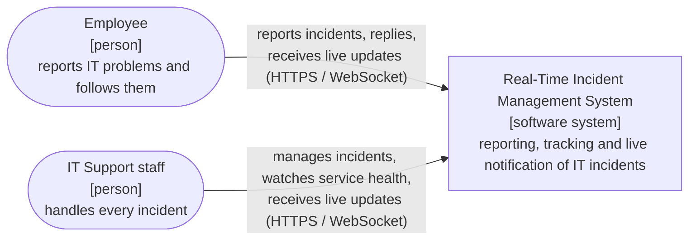
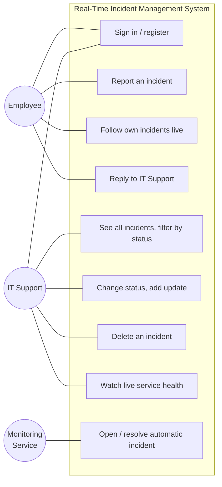

# 01 Overview

[Index](README.md) · [01 Overview](01-overview.md) · [02 Architecture](02-architecture.md) · [03 Communication](03-communication.md) · [04 Data model](04-data-model.md) · [05 API](05-api-reference.md) · [07 Design decisions](07-design-decisions.md)

## What the system does

The Real-Time Incident Management System is used by an IT support team. Employees report technical problems
(for example "VPN connection unavailable"), follow the status of their own reports and talk to IT Support.
IT Support staff see every incident, change its status, add updates and remove incidents. A monitoring service
watches the backend services and opens a Critical incident automatically when one of them fails.

Every change is pushed to the browsers of the people concerned **in real time**: pages update without reloading.

## Course requirements and how they are met

| Requirement | How the project meets it |
|---|---|
| 3–4 microservices | Four services: User, Incident, Notification and Monitoring Service (the API Gateway is infrastructure, not counted) |
| Client | SvelteKit + TypeScript web client with an Employee and an IT Support workspace |
| Any programming language | C# / ASP.NET Core (.NET 9) for the backend, TypeScript for the client |
| Real-time communication | ASP.NET Core SignalR (WebSocket) with per-user and per-role groups |
| Documentation in `docs/` | This folder |
| Diagrams in Mermaid | Every diagram in the repository is a Mermaid block; sources in [`diagrams/`](diagrams/) |

## Services

| Service | Responsibility | Port (local) |
|---|---|---|
| **User Service** | Registration and login, password hashing, issuing JWT tokens | 5001 |
| **Incident Service** | Incidents and their lifecycle, updates and replies, role-based permissions | 5002 |
| **Notification Service** | SignalR hub, delivers events to the right users, notification history | 5003 |
| **Monitoring Service** | Health checks every 5 seconds, automatic Critical incidents, live status for IT Support | 5004 |
| API Gateway | Single entry point (YARP reverse proxy), CORS, login rate limiting | 5000 |
| Client | Browser UI (SvelteKit) | 5173 |

## Users

| Role | Can do |
|---|---|
| **Employee** | Sign in, report incidents, see **only their own** incidents with the full history, reply to IT Support, receive changes live |
| **IT Support** | Sign in, see **all** incidents, filter by status, change status, add updates, delete incidents, watch live service health |

## System context (C4 level 1)

Who uses the system and for what. The system is a single box at this level.

Source: [`diagrams/00-c4-context.mmd`](diagrams/00-c4-context.mmd) · Image: [`diagrams/00-c4-context.png`](diagrams/00-c4-context.png)

## Use cases

Source: [`diagrams/08-use-cases.mmd`](diagrams/08-use-cases.mmd) · Image: [`diagrams/08-use-cases.png`](diagrams/08-use-cases.png)

## Technology

| Concern | Choice | Why |
|---|---|---|
| Backend | ASP.NET Core minimal APIs, .NET 9, C# | Small, fast services with very little boilerplate |
| Real-time | ASP.NET Core SignalR | WebSocket with automatic fallback, reconnect support and groups |
| Gateway | YARP | Microsoft's reverse proxy, configured in `appsettings.json` |
| Authentication | JWT (HMAC-SHA256) + PBKDF2 password hashes | Stateless: every service verifies the token itself |
| Client | SvelteKit 2, Svelte 5, TypeScript | Reactive UI with little code; production build runs on Node |
| Storage | In memory, one store per service | Each service owns its data; no shared database |
| Packaging | Docker multi-stage images, Docker Compose | One command starts the whole system |
| Tests | xUnit + WebApplicationFactory, Node.js end-to-end tests | Integration tests per service and tests of the running system |
