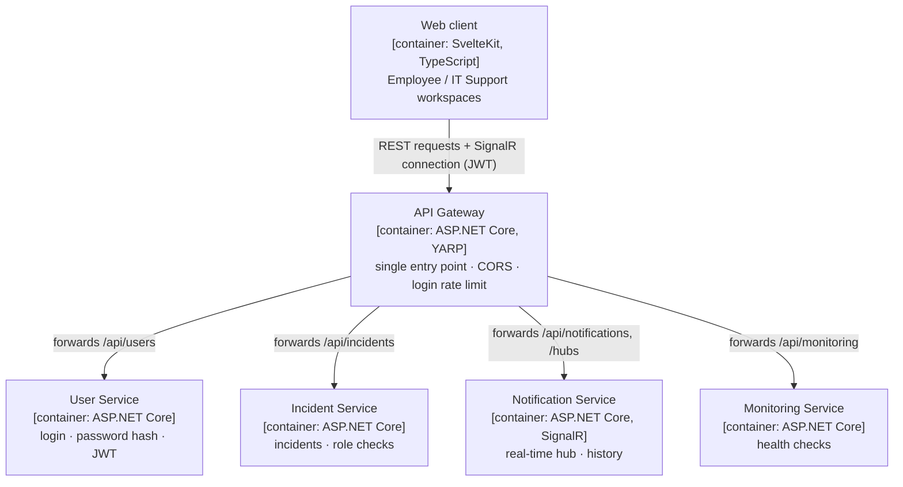
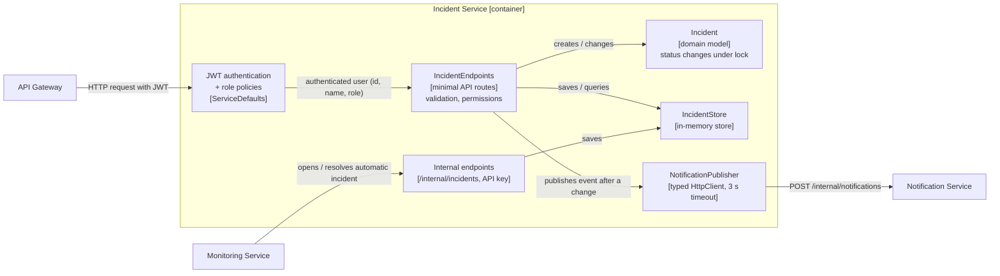
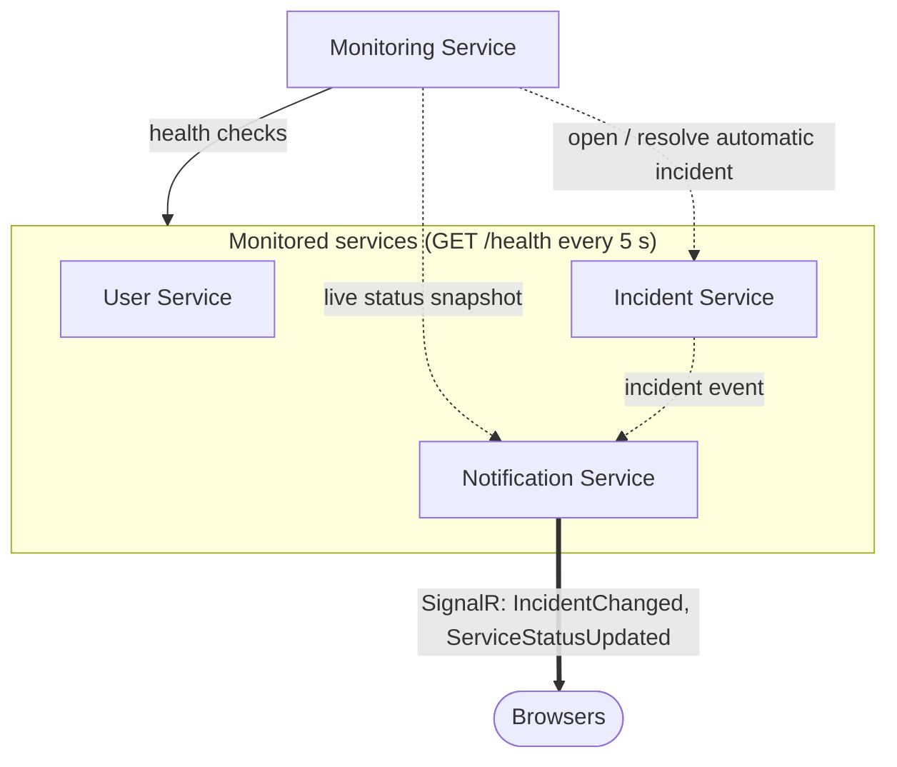
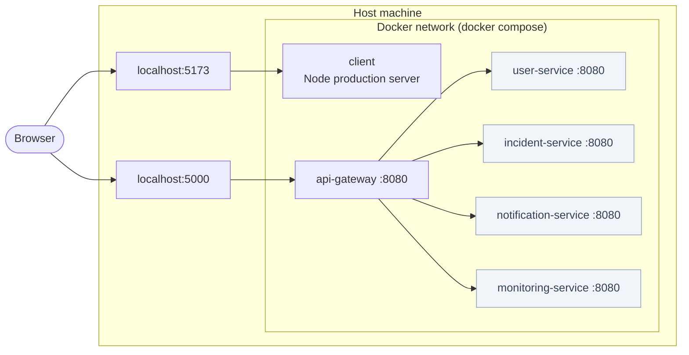

# 02 Architecture

[Index](README.md) · [01 Overview](01-overview.md) · [02 Architecture](02-architecture.md) · [03 Communication](03-communication.md) · [04 Data model](04-data-model.md) · [05 API](05-api-reference.md) · [07 Design decisions](07-design-decisions.md)

The architecture is described with the views of the C4 model taught in the course: the
[system context](01-overview.md#system-context-c4-level-1) (level 1), the containers (level 2) and the components of one
container (level 3). Sequence and state diagrams are in [03 Communication](03-communication.md).

## Container view (C4 level 2)

Which deployable parts the system consists of and how they talk to each other. The browser only talks to the
**API Gateway**; the gateway forwards each path to the service responsible for it.

Source: [`diagrams/01-architecture.mmd`](diagrams/01-architecture.mmd) · Image: [`diagrams/01-architecture.png`](diagrams/01-architecture.png)

## Component view of the Incident Service (C4 level 3)

What happens inside one container when a request arrives. The other services follow the same structure.

Source: [`diagrams/13-incident-service-components.mmd`](diagrams/13-incident-service-components.mmd) · Image: [`diagrams/13-incident-service-components.png`](diagrams/13-incident-service-components.png)

## Service-to-service communication

Services call each other through `/internal/...` endpoints. These endpoints are **not** routed by the gateway and
every call must contain the shared `X-Internal-Api-Key` header.

Source: [`diagrams/01b-internal-communication.mmd`](diagrams/01b-internal-communication.mmd) · Image: [`diagrams/01b-internal-communication.png`](diagrams/01b-internal-communication.png)

| From | To | Endpoint | Purpose |
|---|---|---|---|
| Incident Service | Notification Service | `POST /internal/notifications` | Publish an incident event |
| Monitoring Service | Notification Service | `POST /internal/service-status` | Push the live health snapshot |
| Monitoring Service | Incident Service | `POST /internal/incidents` | Open an automatic Critical incident |
| Monitoring Service | Incident Service | `POST /internal/incidents/{id}/resolve` | Resolve it after recovery |
| Monitoring Service | User / Incident / Notification | `GET /health` | Health check every 5 seconds |

## Deployment view

With Docker Compose only the client (5173) and the gateway (5000) are published on the host. The four
microservices are reachable only inside the Docker network, so nobody can bypass the gateway.

Source: [`diagrams/07-deployment.mmd`](diagrams/07-deployment.mmd) · Image: [`diagrams/07-deployment.png`](diagrams/07-deployment.png)

## Why these are microservices

- Each service is a separate ASP.NET Core project with its own process, port, Dockerfile and container.
- Each service owns its data; there is no shared database.
- Services communicate only over the network (HTTP and SignalR) and never call each other's code.
- A failure of one service does not stop the others (see [failure behaviour](03-communication.md#failure-behaviour)).

## Code organization

Every service is split into folders by responsibility; `Program.cs` only wires things together.

| Folder | Contents | Example |
|---|---|---|
| `Models/` | Domain types | `Incident`, `User` |
| `Contracts/` | Request and response records of the public API | `CreateIncidentRequest` |
| `Data/` | In-memory stores (thread-safe) | `IncidentStore`, `UserStore` |
| `Endpoints/` | Minimal-API route groups | `IncidentEndpoints.cs` |
| `Services/`, `Clients/` | Outgoing HTTP calls (typed `HttpClient`, 3 s timeout) | `NotificationPublisher` |
| `Security/` | Password hashing and token creation | `PasswordHasher`, `TokenService` |
| `Workers/`, `State/`, `Options/` | Background monitoring loop, health state, settings | `MonitoringWorker` |

| Repository folder | Contents |
|---|---|
| `services/user-service`, `incident-service`, `notification-service`, `monitoring-service` | The four microservices |
| `api-gateway/` | YARP reverse proxy |
| `shared/ServiceDefaults/` | Cross-cutting code only: JWT setup, internal API key, health endpoint, message contracts |
| `client/` | SvelteKit client (`src/lib`: api, realtime, session, workspace, components; `src/routes`: user, it) |
| `tests/` | xUnit integration tests and end-to-end tests |
| `scripts/`, `*.cmd`, `.vscode/tasks.json` | Start, stop and test the system |
| `docs/` | This documentation |

The shared `ServiceDefaults` library contains **no business logic** — the same approach as Microsoft's eShop
reference application. Every service still builds and runs on its own.

## Security model

| Measure | Protects against | Where |
|---|---|---|
| Password login, PBKDF2-SHA256 (100 000 iterations, random salt) | Impersonation, leaked passwords | User Service |
| Signed JWT (HMAC-SHA256, 8 h), verified by every service | Forged identities, bypassing the gateway | `ServiceDefaults/Auth` |
| Role checks on the server | Employees changing status or deleting | Incident Service |
| Reporter taken from the token, not the request body | Reporting in someone else's name | Incident Service |
| SignalR groups | Employees receiving other people's events | Notification Service |
| `/internal` endpoints + API key, not routed by the gateway | Fake notifications or incidents | All services |
| Only gateway and client published in Docker | Direct access to services | `docker-compose.yml` |
| CORS limited to the client origin | Other websites calling the API | Gateway |
| Login rate limit (20 / minute / IP) | Password guessing | Gateway |
| Allowed values and length limits | Invalid or oversized data | Endpoints |
| Constant-time comparisons | Timing attacks on hashes and keys | `PasswordHasher`, `InternalApiKey` |
| Services refuse to start without keys outside Development | Running with insecure defaults | `ServiceDefaults/Auth` |
