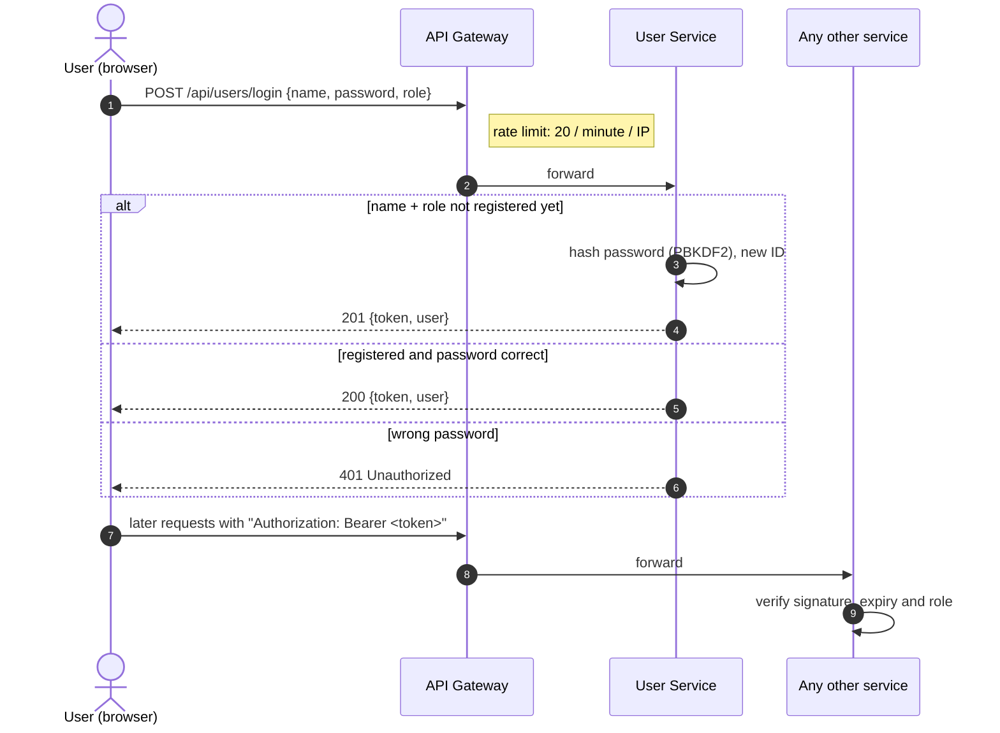
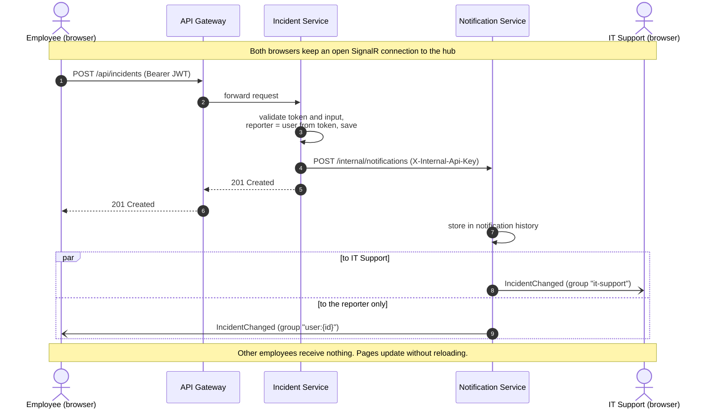
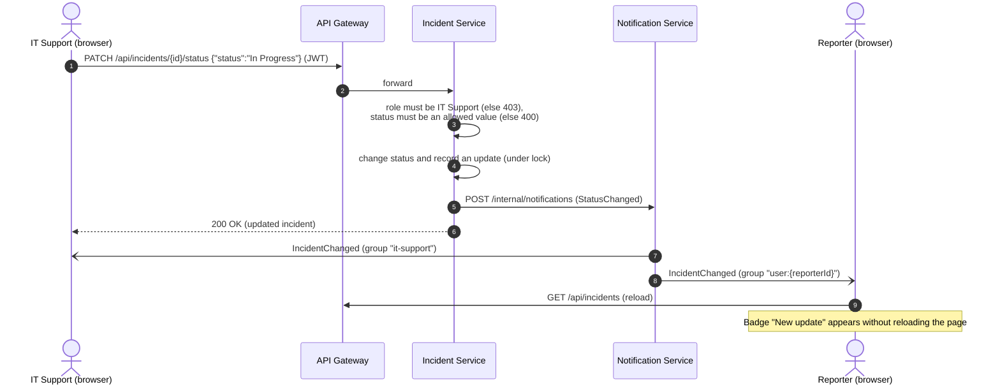
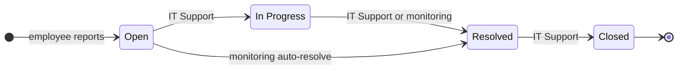
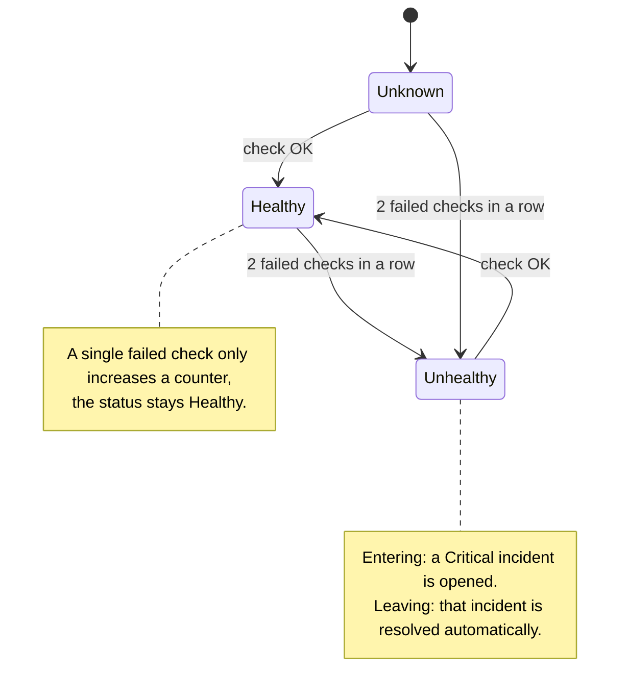
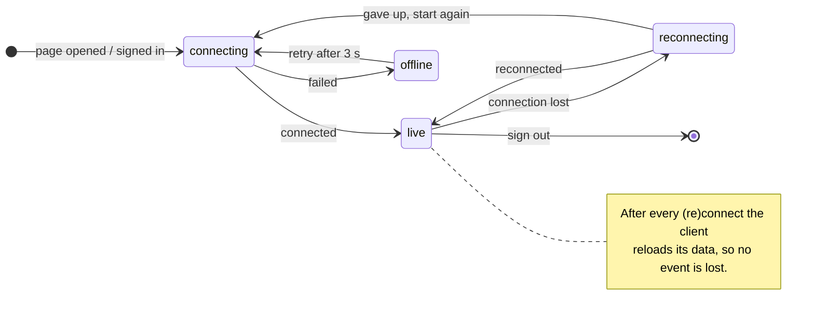
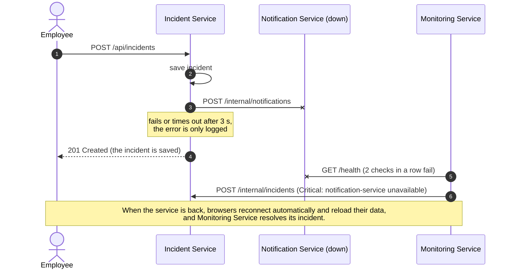
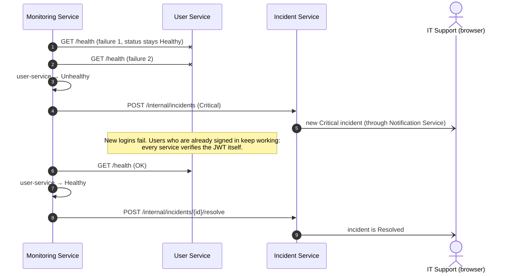

# 03 Communication

[Index](README.md) · [01 Overview](01-overview.md) · [02 Architecture](02-architecture.md) · [03 Communication](03-communication.md) · [04 Data model](04-data-model.md) · [05 API](05-api-reference.md) · [07 Design decisions](07-design-decisions.md)

## Register and log in

The same endpoint registers a new user on the first login and checks the password afterwards. The returned JWT
is sent with every later request.

Source: [`diagrams/03-login-sequence.mmd`](diagrams/03-login-sequence.mmd) · Image: [`diagrams/03-login-sequence.png`](diagrams/03-login-sequence.png)

## Report an incident (real-time)

Source: [`diagrams/02-realtime-sequence.mmd`](diagrams/02-realtime-sequence.mmd) · Image: [`diagrams/02-realtime-sequence.png`](diagrams/02-realtime-sequence.png)

## Change status (real-time)

Source: [`diagrams/09-status-change-sequence.mmd`](diagrams/09-status-change-sequence.mmd) · Image: [`diagrams/09-status-change-sequence.png`](diagrams/09-status-change-sequence.png)

Replies of the employee work the same way in the other direction: `POST /api/incidents/{id}/updates` →
event to the `it-support` group and to the reporter.

## SignalR groups

The hub (`/hubs/notifications`) requires a valid JWT. Because browsers cannot send headers on WebSocket
connections, the token is sent as the `access_token` query parameter, which the services accept only for `/hubs`
paths. When a connection opens, the hub puts it into a group:

| Connection | Group | Receives |
|---|---|---|
| IT Support user | `it-support` | Every incident event and the monitoring snapshot |
| Employee with ID 1001 | `user:1001` | Only events about incidents reported by user 1001 |

**The server decides who receives an event.** An employee's browser never receives anything about other
people's incidents.

| SignalR event | Sent to | Content |
|---|---|---|
| `IncidentChanged` | `it-support` + reporter's group | Type (`Created`, `StatusChanged`, `Updated`, `Deleted`), incident data, actor, message |
| `ServiceStatusUpdated` | `it-support` | Health of the three monitored services, every 5 seconds |

## Incident lifecycle

Source: [`diagrams/04-incident-lifecycle.mmd`](diagrams/04-incident-lifecycle.mmd) · Image: [`diagrams/04-incident-lifecycle.png`](diagrams/04-incident-lifecycle.png)

Updates and replies can be added in any state. Only IT Support can change the status; Monitoring Service
resolves the incidents it opened automatically.

## Monitoring

Every 5 seconds Monitoring Service checks the three services **in parallel** (`GET /health`, 3-second timeout)
and pushes the snapshot to IT Support. A service becomes *Unhealthy* only after **two failed checks in a row**,
so a single slow answer or a service that is still starting does not cause a false alarm.

Source: [`diagrams/05-monitoring-states.mmd`](diagrams/05-monitoring-states.mmd) · Image: [`diagrams/05-monitoring-states.png`](diagrams/05-monitoring-states.png)

## Client connection

The client retries the first connection until it succeeds and reloads its data after every (re)connect, so
events that happened while it was offline are not lost.

Source: [`diagrams/12-reconnect.mmd`](diagrams/12-reconnect.mmd) · Image: [`diagrams/12-reconnect.png`](diagrams/12-reconnect.png)

## Failure behaviour

### Notification Service is down

Source: [`diagrams/10-failure-notification-down.mmd`](diagrams/10-failure-notification-down.mmd) · Image: [`diagrams/10-failure-notification-down.png`](diagrams/10-failure-notification-down.png)

- Incidents are still created, updated and deleted; the publishing call times out after 3 seconds and is logged.
- Browsers show the connection as offline and keep retrying; when the service is back they reconnect and reload.

### User Service is down

Source: [`diagrams/11-failure-user-service-down.mmd`](diagrams/11-failure-user-service-down.mmd) · Image: [`diagrams/11-failure-user-service-down.png`](diagrams/11-failure-user-service-down.png)

- New logins fail, but users who are already signed in keep working because every service verifies the JWT itself.

### Incident Service is down

- API calls about incidents return an error that the client shows to the user.
- Monitoring Service marks it *Unhealthy* but cannot open an automatic incident (the service that would store it
  is the one that is down); this is logged.

### API Gateway is down

- The client cannot reach anything and shows the connection as offline. It keeps retrying every 3 seconds and
  continues automatically when the gateway is back.

### Two requests change the same data at the same time

- Changes of an incident (status, updates) go through methods protected by a lock, so no update is lost.
  An integration test sends 50 updates in parallel and checks that all 50 are stored.
- "Find or create user" also runs under a lock, so two simultaneous first logins with the same name cannot
  create two users.
