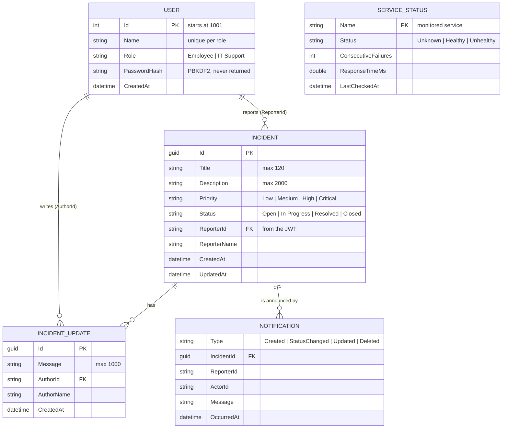

# 04 Data model

[Index](README.md) · [01 Overview](01-overview.md) · [02 Architecture](02-architecture.md) · [03 Communication](03-communication.md) · [04 Data model](04-data-model.md) · [05 API](05-api-reference.md) · [07 Design decisions](07-design-decisions.md)

Entity-relationship view of the data. The entities are owned by different services (see the table below);
relationships between services are kept only through IDs, never through a shared database.

Source: [`diagrams/06-data-model.mmd`](diagrams/06-data-model.mmd) · Image: [`diagrams/06-data-model.png`](diagrams/06-data-model.png)

## Data owned by each service

Every service keeps its own data in memory. There is no shared database; services refer to each other only by IDs.

| Service | Stores | Notes |
|---|---|---|
| User Service | Users: ID, name, role, creation time, password hash | IDs start at 1001; the same name + role always maps to the same user |
| Incident Service | Incidents with their list of updates | The reporter is stored as `ReporterId` / `ReporterName` from the JWT |
| Notification Service | The latest 200 incident notifications | Used for the "Recent activity" list after login |
| Monitoring Service | Health state per service, consecutive failures, ID of the open automatic incident | Used to open and later resolve automatic incidents |

## Allowed values and validation

| Field | Rule | Error |
|---|---|---|
| User name | required, max. 60 characters | 400 |
| Password | 4–128 characters | 400 |
| Role | `Employee` or `IT Support` (case-insensitive) | 400 |
| Incident title | required, max. 120 characters | 400 |
| Description | max. 2000 characters | 400 |
| Update / reply message | required, max. 1000 characters | 400 |
| Priority | `Low`, `Medium`, `High`, `Critical` (default `Medium`) | 400 |
| Status | `Open`, `In Progress`, `Resolved`, `Closed` | 400 |

## Message contracts between services

Defined once in `shared/ServiceDefaults/Contracts/Messages.cs` and used by both sides.

| Contract | Fields | Sent by → to |
|---|---|---|
| `IncidentNotification` | Type, IncidentId, Title, Priority, Status, ReporterId, ReporterName, ActorId, ActorName, Message, OccurredAt | Incident Service → Notification Service → browsers |
| `ServiceStatus` | Name, Status, LastCheckedAt, ResponseTimeMs, ConsecutiveFailures, Error | Monitoring Service → Notification Service → IT Support |

## JWT claims

| Claim | Meaning | Example |
|---|---|---|
| `sub` | User ID | `1001` |
| `name` | User name | `Meric` |
| `role` | Role | `Employee` |

## Persistence

Data is kept in memory on purpose (prototype). Restarting a service clears its data. Because every service
already owns its data, the next step would be one database per service; see
[07 Design decisions](07-design-decisions.md#known-limitations).
