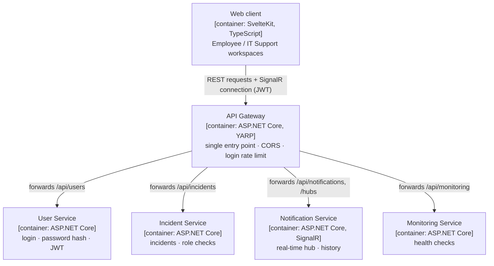

# Real-Time Incident Management System – Documentation

A microservice-based web application for reporting, tracking and resolving IT incidents in real time
(Programming 5 project).

| Page | Contents |
|---|---|
| [01 Overview](01-overview.md) | What the system does, course requirements, services, use cases, technology |
| [02 Architecture](02-architecture.md) | Component, internal-communication and deployment views, code organization, security model |
| [03 Communication](03-communication.md) | Real-time flows, login, status changes, SignalR groups, monitoring, failure behaviour |
| [04 Data model](04-data-model.md) | Data owned by each service, message contracts, validation rules |
| [05 API reference](05-api-reference.md) | Gateway routing, every endpoint with access rules, SignalR events, curl examples |
| [07 Design decisions](07-design-decisions.md) | Why each choice was made, known limitations, likely questions |

All diagrams are written in **Mermaid** and rendered directly by GitHub. Their sources (`.mmd`) and exported
images (`.png`) are in [`diagrams/`](diagrams/).

Source: [`diagrams/01-architecture.mmd`](diagrams/01-architecture.mmd) · Image: [`diagrams/01-architecture.png`](diagrams/01-architecture.png)
